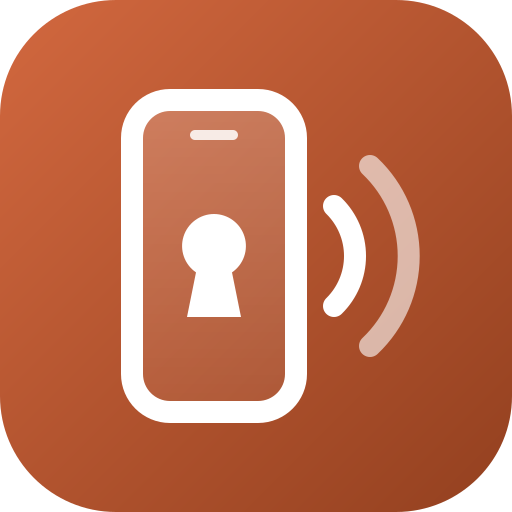
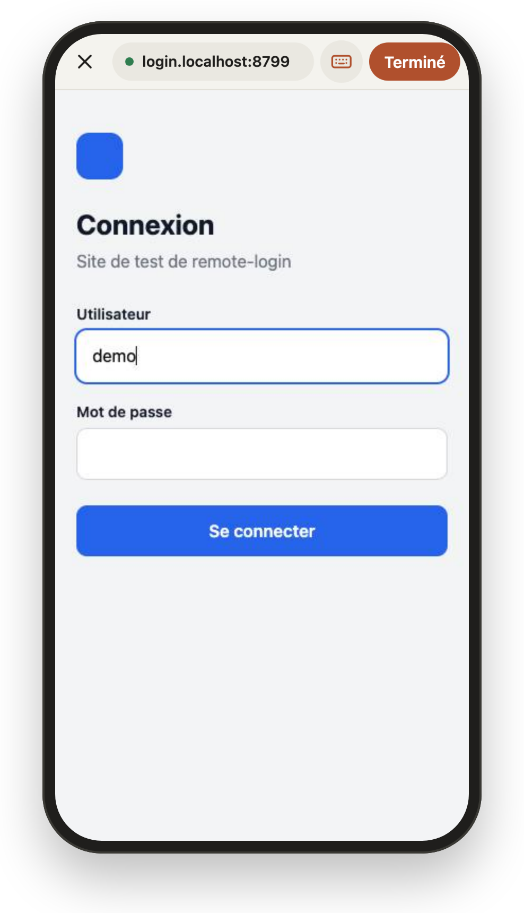
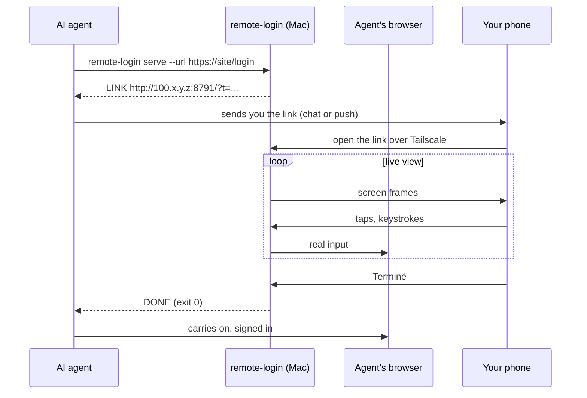

<div align="center">

[](README.md)



# remote-login

**Sign in to your AI agent's browser from your phone.**<br>
Your agent hits a login page, sends you a link, you sign in on a live view. It never sees your password.

[](LICENSE)
[](#requirements)
[](remote-login)
[](https://docs.astral.sh/uv/)
[](https://tailscale.com)
[](SKILL.md)

</div>

https://github.com/user-attachments/assets/b3ff69d6-79d3-4b9e-ae87-73ad5b4a7406

<p align="center"></p>

## Why

Browser agents get stuck on sign-in pages, 2FA prompts and captchas. When you are away from the Mac, "please sign in" means the task waits until you are back. And pasting a password into the chat is not an option.

remote-login turns that into a link on your phone. Tap it, sign in like on any website, tap **Terminé**, and the agent carries on.

## How it works



- **Feels like a browser.** Full screen, sized to your phone. Tap a field and your phone keyboard opens; what you type lands live in the page. Swipe to scroll.
- **Credentials never reach the agent.** They go phone → server → browser, and are never logged or stored.
- **Private by default.** The page listens on the Mac's Tailscale address only, behind a one-time token. It stops on Terminé, Annuler or after 15 minutes.
- **Two targets.** `pane` drives the Claude desktop app's built-in browser. `headless` runs a dedicated Brave that works even with the Mac locked.

## Install

```sh
curl -fsSL https://raw.githubusercontent.com/pyxl-dev/remote-login/main/install.sh | sh
```

The installer puts the code in `~/.local/share/remote-login`, links `remote-login` into `~/.local/bin`, builds the Swift helper and installs the Claude Code skill. Run it again to update; `--uninstall` removes it. It only touches your home folder.

### Let your AI agent do it

Paste this into Claude Code, Codex, Cursor or any agent with a shell:

```text
Install and use remote-login: https://github.com/pyxl-dev/remote-login
Follow the AGENTS.md in that repository.
```

[`AGENTS.md`](AGENTS.md) tells the agent how to install it, when to use it, how to read the result, and the safety rules (never ask for a password in chat).

### Requirements

| | Needed for |
| --- | --- |
| macOS | everything |
| [uv](https://docs.astral.sh/uv/) | running the script (it fetches Python and dependencies itself) |
| [Tailscale](https://tailscale.com/download) on the Mac and the phone | reaching the page from the phone |
| [Brave](https://brave.com/download) | the `headless` target |
| Claude desktop app + Xcode command line tools (`swiftc`) | the `pane` target |

## Usage

```sh
remote-login serve --host example.com --url https://example.com/login --notify
```

| Option | Default | |
| --- | --- | --- |
| `--target auto\|pane\|headless` | `auto` | `auto` picks `pane` when the Mac is unlocked and the pane visible, else `headless` |
| `--url URL` | | sign-in page to open (required for a fresh `headless` browser) |
| `--host HOST` | | site being signed in to: picks the pane page, named in the push |
| `--minutes N` | `15` | give up after this long |
| `--notify` | off | also send the link with your notify script (below) |
| `--bind ADDR`, `--port N` | Tailscale IPv4, `8791` | where the page listens |

It prints `TARGET <t>` and `LINK <url>`, then blocks until you are done:

| Exit | Output | Meaning |
| --- | --- | --- |
| `0` | `DONE` | you tapped Terminé |
| `3` | `CANCELLED` | you tapped Annuler |
| `2` | `TIMEOUT` | nobody finished in time |

`remote-login headless-stop` stops the headless Brave. Its profile (`~/.cache/remote-login/profile`) keeps your sign-ins for next time; any CDP client on `http://127.0.0.1:9334` can continue there.

### Push the link to your phone

`--notify` runs `~/.config/remote-login/notify LINK MESSAGE` (or `$REMOTE_LOGIN_NOTIFY`). Write it with whatever reaches you, for example [ntfy](https://ntfy.sh):

```sh
#!/bin/sh
curl -s -H "Click: $1" -d "$2" https://ntfy.sh/your-private-topic
```

## Security

- One-time random token in the link, checked in constant time. The first browser that opens the page claims it (session cookie): the same link opened elsewhere is refused. The server stops as soon as you finish or cancel.
- Bound to the Tailscale address, so only devices on your tailnet can reach it.
- Request bodies are never logged; typed text is not kept after it is sent to the browser.
- The headless browser listens for CDP on `127.0.0.1` only, with its own profile in `~/.cache/remote-login` (mode 700).

## Development

```sh
git clone https://github.com/pyxl-dev/remote-login && cd remote-login
./install.sh                 # installs this clone
python3 test/login-fixture.py   # test sign-in site on 127.0.0.1:8799 (demo / demo-pass-8799)
```

Test the headless target without touching a real sign-in: `REMOTE_LOGIN_CDP_PORT` and `REMOTE_LOGIN_PROFILE` move the browser elsewhere.

```sh
REMOTE_LOGIN_CDP_PORT=9344 REMOTE_LOGIN_PROFILE=/tmp/rl ./remote-login serve \
  --target headless --bind 127.0.0.1 --port 8792 --url http://login.localhost:8799/
```

| File | |
| --- | --- |
| `remote-login` | server and CLI (uv script) |
| `page.html` | the phone page |
| `helper/main.swift` | finds the desktop app's browser pane (Accessibility) and posts real mouse and keyboard events |
| `SKILL.md` | Claude Code skill |
| `AGENTS.md` | instructions for any AI agent |
| `install.sh` | installer |

## License

[MIT](LICENSE)
