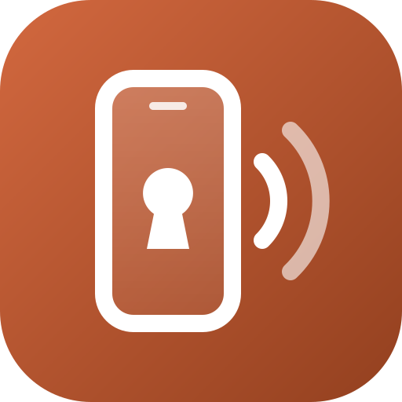
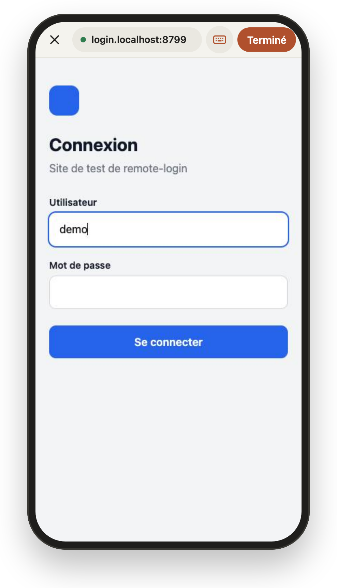
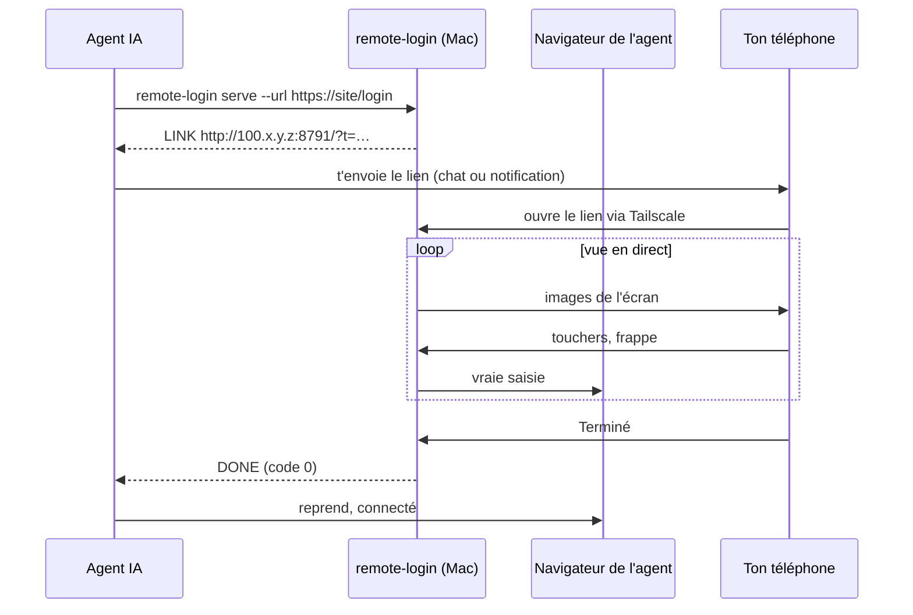

<div align="center">

[](README.en.md)



# remote-login

**Connecte-toi au navigateur de ton agent IA depuis ton téléphone.**<br>
Ton agent tombe sur une page de connexion, il t'envoie un lien, tu te connectes sur une vue en direct. Il ne voit jamais ton mot de passe.

[](LICENSE)
[](#prérequis)
[](remote-login)
[](https://docs.astral.sh/uv/)
[](https://tailscale.com)
[](SKILL.md)

</div>

<p align="center"></p>

## Pourquoi

Les agents qui pilotent un navigateur se bloquent sur les pages de connexion, la double authentification et les captchas. Quand tu n'es pas devant le Mac, « connecte-toi s'il te plaît » veut dire que la tâche attend ton retour. Et coller un mot de passe dans le chat, c'est non.

remote-login transforme ça en un lien sur ton téléphone. Tu l'ouvres, tu te connectes comme sur n'importe quel site, tu touches **Terminé**, et l'agent reprend.

## Comment ça marche



- **Comme un vrai navigateur.** Plein écran, à la taille de ton téléphone. Tu touches un champ, ton clavier s'ouvre, et ce que tu tapes arrive en direct dans la page. Tu glisses pour défiler.
- **Tes identifiants ne passent jamais par l'agent.** Ils vont du téléphone au serveur puis au navigateur, sans être enregistrés nulle part.
- **Privé par défaut.** La page n'écoute que sur l'adresse Tailscale du Mac, derrière un jeton à usage unique. Elle s'arrête sur Terminé, sur Annuler ou au bout de 15 minutes.
- **Deux navigateurs possibles.** `pane` pilote le navigateur intégré de l'app Claude. `headless` lance un Brave dédié, qui marche même Mac verrouillé.

## Installation

```sh
curl -fsSL https://raw.githubusercontent.com/pyxl-dev/remote-login/main/install.sh | sh
```

L'installateur met le code dans `~/.local/share/remote-login`, rend la commande `remote-login` disponible dans `~/.local/bin`, compile la petite partie en Swift et installe le skill Claude Code. Relance-le pour mettre à jour ; `--uninstall` enlève tout. Il ne touche qu'à ton dossier perso.

### Laisse ton agent IA s'en occuper

Colle ceci dans Claude Code, Codex, Cursor ou n'importe quel agent qui a accès à un terminal :

```text
Installe et utilise remote-login : https://github.com/pyxl-dev/remote-login
Suis le fichier AGENTS.md de ce dépôt.
```

[`AGENTS.md`](AGENTS.md) explique à l'agent comment l'installer, quand s'en servir, comment lire le résultat, et les règles de sécurité (ne jamais demander de mot de passe dans le chat). Il est en anglais, la langue que tous les agents lisent.

### Prérequis

| | Sert à |
| --- | --- |
| macOS | tout |
| [uv](https://docs.astral.sh/uv/) | lancer le script (il récupère Python et les dépendances tout seul) |
| [Tailscale](https://tailscale.com/download) sur le Mac et le téléphone | ouvrir la page depuis le téléphone |
| [Brave](https://brave.com/download) | le mode `headless` |
| App Claude + outils en ligne de commande Xcode (`swiftc`) | le mode `pane` |

## Utilisation

```sh
remote-login serve --host example.com --url https://example.com/login --notify
```

| Option | Par défaut | |
| --- | --- | --- |
| `--target auto\|pane\|headless` | `auto` | `auto` choisit `pane` si le Mac est déverrouillé et le navigateur intégré affiché, sinon `headless` |
| `--url URL` | | page de connexion à ouvrir (obligatoire pour un `headless` qui démarre) |
| `--host HOST` | | site concerné : sert à trouver la page dans `pane`, et à le nommer dans la notification |
| `--minutes N` | `15` | abandonne au bout de ce délai |
| `--notify` | non | envoie aussi le lien avec ton script de notification (plus bas) |
| `--bind ADDR`, `--port N` | IPv4 Tailscale, `8791` | où la page écoute |

La commande affiche `TARGET <t>` et `LINK <url>`, puis attend que tu aies fini :

| Code | Sortie | Signification |
| --- | --- | --- |
| `0` | `DONE` | tu as touché Terminé |
| `3` | `CANCELLED` | tu as touché Annuler |
| `2` | `TIMEOUT` | personne n'a fini à temps |

`remote-login headless-stop` arrête le Brave headless. Son profil (`~/.cache/remote-login/profile`) garde tes connexions pour la prochaine fois ; n'importe quel client CDP sur `http://127.0.0.1:9334` peut continuer dedans.

### Recevoir le lien en notification

`--notify` lance `~/.config/remote-login/notify LIEN MESSAGE` (ou `$REMOTE_LOGIN_NOTIFY`). Écris-le avec ce qui te joint le mieux, par exemple [ntfy](https://ntfy.sh) :

```sh
#!/bin/sh
curl -s -H "Click: $1" -d "$2" https://ntfy.sh/ton-sujet-prive
```

## Sécurité

- Un jeton aléatoire à usage unique dans le lien, vérifié en temps constant. Le serveur s'arrête dès que tu termines ou annules.
- La page n'écoute que sur l'adresse Tailscale : seuls les appareils de ton réseau Tailscale peuvent l'ouvrir.
- Le contenu des requêtes n'est jamais journalisé ; le texte tapé n'est pas gardé une fois envoyé au navigateur.
- Le Brave headless n'accepte le CDP que sur `127.0.0.1`, avec son propre profil dans `~/.cache/remote-login` (droits 700).

## Développement

```sh
git clone https://github.com/pyxl-dev/remote-login && cd remote-login
./install.sh                    # installe ce clone
python3 test/login-fixture.py   # site de test sur 127.0.0.1:8799 (demo / demo-pass-8799)
```

Pour tester le mode headless sans toucher à une vraie connexion, `REMOTE_LOGIN_CDP_PORT` et `REMOTE_LOGIN_PROFILE` déplacent le navigateur ailleurs :

```sh
REMOTE_LOGIN_CDP_PORT=9344 REMOTE_LOGIN_PROFILE=/tmp/rl ./remote-login serve \
  --target headless --bind 127.0.0.1 --port 8792 --url http://login.localhost:8799/
```

| Fichier | |
| --- | --- |
| `remote-login` | serveur et commande (script uv) |
| `page.html` | la page du téléphone |
| `helper/main.swift` | trouve le navigateur intégré de l'app Claude (Accessibilité) et envoie de vrais clics et frappes |
| `SKILL.md` | skill Claude Code |
| `AGENTS.md` | instructions pour n'importe quel agent IA |
| `install.sh` | installateur |

## Licence

[MIT](LICENSE)
